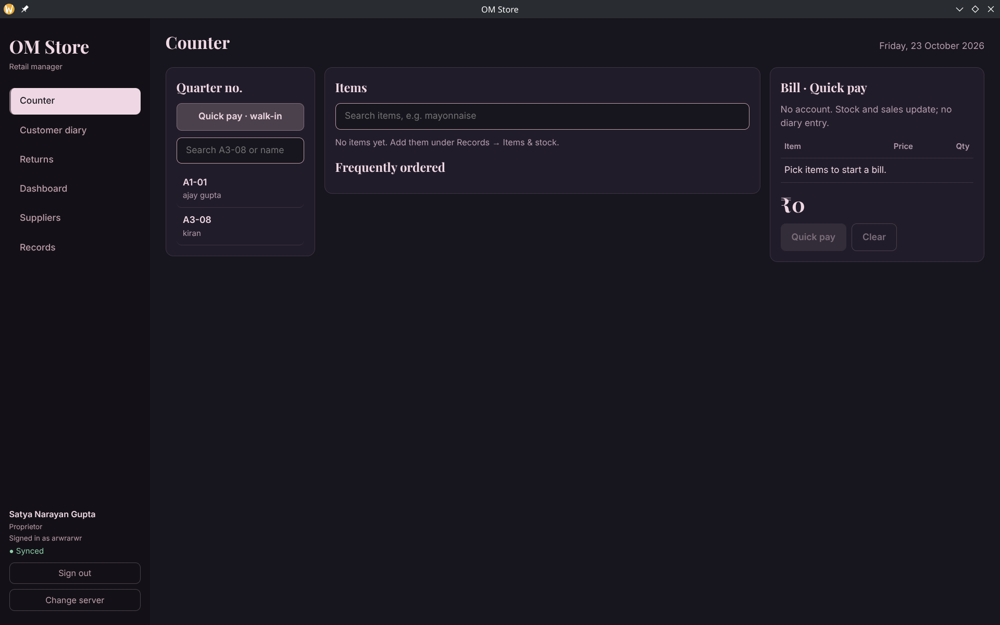
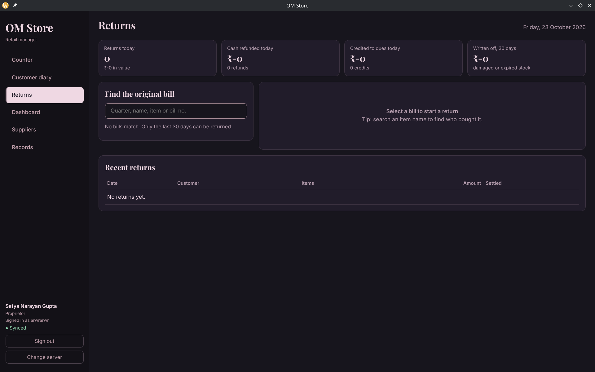
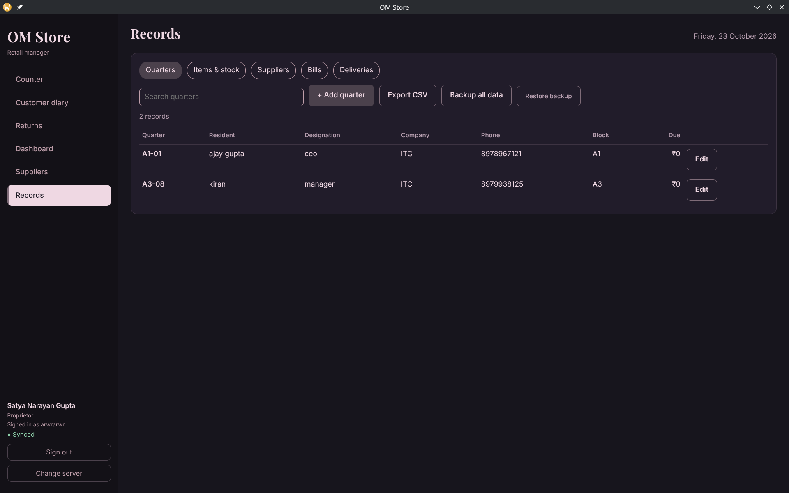
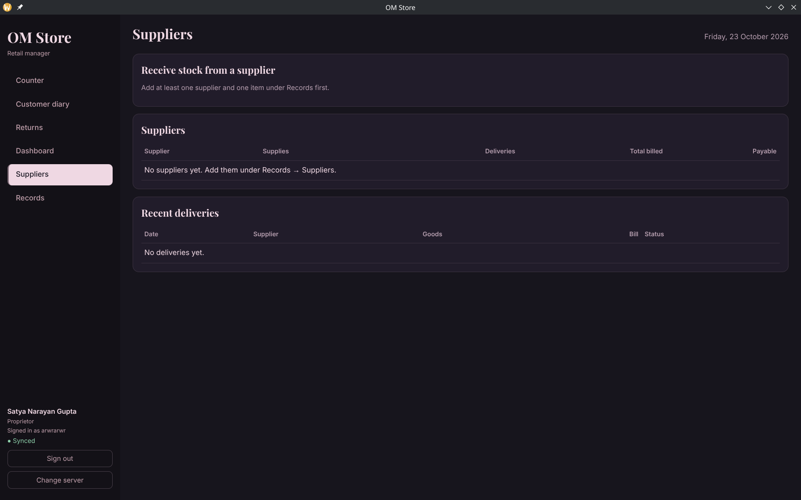

  

<h1 align="center">Retail Inventory Management System</h1>

  <em>Total Quality Management · Semester 5 · 2026</em> 
  Client: OM Store, Century Pulp and Paper 
  Report 02 · Initial Prototype Review

<table>
  <tr>
    <td width="50%" valign="top">
      
      <h3>counter</h3>
      changes in the UI were made, for a more professional look
    </td>
    <td width="50%" valign="top">
      
      <h3>returns</h3>
        client's concerns regarding return policies, were addressed
    </td>
  </tr>
  <tr>
    <td width="50%" valign="top">
      
      <h3>records</h3>
      filler data was removed, so client could start feeding their own data.
    </td>
    <td width="50%" valign="top">
      
      <h3>supplier's dashboard</h3>
      suppliers record data was improved. 
    </td>
  </tr>
</table>